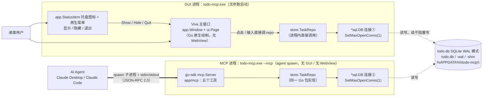

# 桌面端待办任务管理工具 · Viva 迁移设计文档

> 文档状态：方案设计中（技术栈由 Tauri 2 全量迁移至 Viva）
> 创建日期：2026-11-23
> 上游文档：`requirements.md`（需求已确认）、`design.md`（原 Tauri 2 方案，514 行）
> 本文档为设计产物，**不含任何业务代码**；文中代码块仅用于说明 API 形态、结构约定与依赖示意。
> 所有外部能力结论均于 2026-11-23 通过官方文档/官方仓库实际访问核实，逐条附来源 URL。

---

## 1. 迁移决策与代价

### 1.1 决策

用户已明确指示“重构使用 viva 框架”。据此，**放弃原 Tauri 2（Rust + Vue 3 + WebView2）实现，全量迁移到 Viva（github.com/vivaui/viva，Go-first、GPU 原生桌面 GUI 框架）**。这不是增量替换某一层，而是运行时的整体更换：GUI 渲染栈、后端语言、IPC 机制、MCP server 实现全部重写。

迁移的必要性与收益（基于官方核实，非推测）：

| 维度 | Tauri 2 原方案 | Viva 新方案 | 依据 |
|------|---------------|-------------|------|
| 渲染栈 | WebView2 浏览器内核（独立子进程树，数十 MB 基线） | 直接调用 Win32 + Direct3D 11 + DirectWrite，**无 WebView、无浏览器引擎、无捆绑运行时** | https://vivaui.dev/zh 、https://vivaui.dev/en/docs/platforms/ |
| 空闲行为 | 浏览器内核常驻 | 未变化的一帧不布局、不重建场景、不向 GPU 提交；默认无后台定时器和轮询，稳定后 CPU 0.0% | https://vivaui.dev/zh |
| 可执行文件 | exe + WebView2 运行时依赖 | 剥离后最小窗口 1.6 MiB（macOS 基准）；Windows release 为 GUI 子系统、去符号的单个 exe，着色器预编译内嵌，不加载着色器编译器、不捆绑系统库 | https://vivaui.dev/zh 、https://vivaui.dev/en/docs/build-and-package/ 、https://vivaui.dev/en/docs/platforms/ |
| 托盘 | Tauri `tray-icon` feature | **原生一等 API `app.Application.AddStatusItem`**，Windows 通知区域 + Win32 原生弹出菜单 | https://vivaui.dev/en/api/app/StatusItem/ 、https://vivaui.dev/en/docs/windows/ |
| 单实例 | tauri-plugin-single-instance | 官方 opt-in 包 `app/singleinstance` | https://raw.githubusercontent.com/vivaui/viva/main/app/singleinstance/singleinstance.go |

结论：迁移方向与原需求的“低内存硬性诉求”一致，且托盘能力没有退化（详见 §2.1）。

### 1.2 必须保留的业务语义（从 `design.md` 原样继承，不因换栈而重新设计）

以下内容属于**业务契约**，Viva 迁移只换实现语言/框架，**不改语义**：

1. **数据模型**：`tasks` 表 DDL、字段含义、CHECK 约束、行级不变式（`status=0` 时 `completed_at` 必须为 NULL）、两个索引、`PRAGMA user_version=1` 迁移门闸（见原文档 §3）。
2. **五个 MCP 工具语义**：`create_task` / `list_tasks` / `update_task` / `complete_task` / `remove_task` 的名称、描述、入参 schema、出参结构、分页与排序规则（见原文档 §4）。
3. **排序规则**：固定 `ORDER BY status ASC, (due_at IS NULL) ASC, due_at ASC, priority DESC, id ASC`，不给 agent 暴露 `order` 参数。
4. **错误语义两层**：入参违反 JSON Schema → JSON-RPC 协议层 `invalid_params`；业务失败（id 不存在、库访问失败）→ 工具结果 `isError=true` + 人类可读中文 message。
5. **时间语义**：存储层 UTC epoch 毫秒 INTEGER；MCP 入参接受合法 RFC3339（含偏移），归一化后入库；出参统一 UTC RFC3339 字符串。
6. **部分更新语义**：字段缺席 = 不动；显式 `null` = 清空；`update_task` 不含 `status` 字段；`complete_task` 幂等，`remove_task` 不幂等且返回删除快照。
7. **并发模型**：单 exe 双模式（GUI 无参数 / MCP `--mcp`），两进程各自一条 SQLite 连接直接读写同一 `todo.db`，WAL + `busy_timeout=5000` + `synchronous=NORMAL`，无中介进程、无 IPC 转发。
8. **内存预算目标**：MCP 模式 ≤20MB；GUI 模式原文档 ≤100MB（含 WebView2 子进程树），**迁移后目标收紧为 ≤50MB**（依据见 §9.3）。
9. **GUI 功能边界与交互**：MVP 九项功能（列表/快捷新建/勾选/删除/行内编辑/筛选/托盘/聚焦重查/防多开），无动效、无主题系统、无组件库、无虚拟滚动以外的多余优化（见原文档 §5）。

### 1.3 必须重写（不可复用）的部分

| 层 | 原实现 | 新实现 | 代价说明 |
|----|--------|--------|----------|
| GUI 前端 | `src/` 下 Vue 3 单文件组件 + Vite（约 8 个源文件） | `app/gui` 下 Go 声明式页面（`func (m *model) page(c ui.C)`） | 全部重写。Viva 无 HTML/CSS/JS/DOM，`v-model`/`computed` 等概念不存在；需按“每次重绘从 model 声明界面、点击在控件声明处处理”的心智模型改写 |
| 后端语言 | Rust（`src-tauri/src/`） | Go 1.26+ | `task_repo`、MCP tools、DTO、迁移代码全部用 Go 重写；业务语义照抄 `design.md`，但代码零复用 |
| MCP server | rmcp 3.11 + tokio(current_thread) | 官方 `modelcontextprotocol/go-sdk` v1.8.0 + `mcp.StdioTransport` | 协议层重写；五个 handler 的业务逻辑从 Rust 移植到 Go |
| SQLite 访问 | rusqlite + bundled | `modernc.org/sqlite`（纯 Go、无 cgo） | SQL 文本与 DDL 语义保留，API 从 rusqlite 换成 `database/sql` |
| IPC | Tauri `invoke` commands | 进程内直接调用 `store.TaskRepo`（GUI 与 MCP 共用同一 Go 包） | 原 `commands/` 薄封装层取消，`app/gui` 直接调 repo；反而更简单 |
| 打包 | `cargo tauri build` + NSIS | `viva build --target windows --arch amd64` + `viva package --format nsis,zip` | 构建脚本/图标配置转为 `viva.toml` |

**明确不做**：不保留 WebView 兼容层、不保留 Vue 前端、不引入 Node.js .toolchain、不引入任何 cgo 依赖、不新增 MVP 之外的功能（提醒/子任务/标签/循环/云同步/HTTP-SSE 仍为二期）。

---

## 2. Viva 能力核实结果（逐条引用官方来源）

> 核实方法：2026-11-23 实际访问 `vivaui.dev` 官方中英文文档、API 参考页、`github.com/vivaui/viva` README/releases/源码与官方示例。以下结论均来自这些来源；未找到的项明确标注。

### 2.1 系统托盘图标 / 菜单：**支持（明确 YES）**

这是本次核实最关键的一条。结论：**Viva 原生支持系统托盘，无需 Win32 `Shell_NotifyIcon` 手写调用，也无需“常驻小窗口”替代方案。**

- 官方命名为 **status area icon / status item**（不是 systray），跨三平台统一 API：`Application.AddStatusItem` 在 macOS 菜单栏、Windows 通知区域、Linux StatusNotifier 托盘放置图标。
  来源：https://vivaui.dev/en/docs/windows/ 、https://vivaui.dev/zh/docs/windows/ 、https://vivaui.dev/en/api/app/StatusItem/
- `app.StatusItem` 官方原文定义：“one icon the application keeps in the system's status area: the menu bar on macOS, the notification area on Windows, the StatusNotifier host (the tray of most Linux desktops) elsewhere.”
  来源：https://vivaui.dev/en/api/app/StatusItem/
- API 形态（官方 `/en/docs/windows/` 页面原样代码，此处仅作 API 示意）：

  ```go
  import "github.com/vivaui/viva/app"

  // 在启动回调或窗口回调中调用（事件循环线程）
  application.AddStatusItem(app.StatusItemConfig{
      Tooltip: "待办",
      Icon:    icon, // app.StatusIcon{Size: 32, RGBA: ...}
      Menu: func() []app.MenuItem {
          return []app.MenuItem{
              {Title: "显示主窗口", OnSelect: window.Show},
              {Title: "隐藏主窗口", OnSelect: window.Hide, Disabled: window.Hidden()},
              {Separator: true},
              {Title: "退出", OnSelect: application.Quit},
          }
      },
  })
  ```

- 关键类型与字段：
  - `func (application *Application) AddStatusItem(config StatusItemConfig) (*StatusItem, error)`，必须从启动回调或窗口回调调用。来源：https://vivaui.dev/en/api/app/Application/
  - `StatusItemConfig{Tooltip string, Icon StatusIcon, OnClick func(StatusClick), Menu func() []MenuItem}`；`Menu` 在每次菜单将要打开时调用，因此菜单项可反映当前状态；Windows 上若无 `OnClick`，主键点击也会打开菜单。来源：https://vivaui.dev/en/api/app/StatusItemConfig/
  - `MenuItem{Title, Separator, Disabled, Checked, Submenu, OnSelect, ID}`；`OnSelect` 在事件循环线程、菜单关闭后运行。来源：https://vivaui.dev/en/api/app/MenuItem/
  - `StatusIcon{Size int, RGBA []byte, Template bool}`；`Size` 建议 ≥32 以适配高 DPI。来源：https://vivaui.dev/en/api/app/StatusIcon/
  - `(*StatusItem).SetIcon` / `SetTooltip` / `Remove`；`Remove` 可从任意 goroutine 调用。来源：https://vivaui.dev/en/api/app/StatusItem/
- **平台差异（需写入实现注意事项）**：Windows 11 新托盘图标可能先进入溢出区，需用户手动提升固定；这是操作系统行为，非 Viva 缺陷。来源：https://vivaui.dev/en/docs/windows/
- 配套能力：`Window.Hide()` / `Show()` / `Hidden()` 明确支持“隐藏主窗口但应用继续在状态区运行”；`Config.OnCloseRequest(allow func())` 可拦截窗口关闭（不调用 `allow` 即保持打开），实现“关闭 = 隐藏到托盘”。来源：https://vivaui.dev/en/api/app/Window/ 、https://vivaui.dev/en/api/app/Config/
- README 也确认菜单后端为原生：macOS `NSMenu` / Windows Win32 popup menu / Linux `com.canonical.dbusmenu`。来源：https://github.com/vivaui/viva

**对需求的影响：无负面影响，不需要替代方案。** 原 `design.md` §5 第 7 项“托盘常驻 + 左键切换显示/隐藏 + 右键菜单”可用官方 API 一比一实现。唯一取舍是 Windows 11 溢出区需用户首次手动固定图标（可在 README 交付说明中提示）。

### 2.2 官方 agent 开发资源

1. **`building-with-viva` skill 真实存在**，是两个 Markdown 文件（`SKILL.md` + `recipes.md`），无可执行代码。官方页面：https://vivaui.dev/en/docs/coding-agents/ （中文：https://vivaui.dev/zh/docs/coding-agents/ ）
   官方安装命令原文（照抄，后续实现 worker 按此接入）：

   ```sh
   mkdir -p .claude/skills/building-with-viva
   curl -fsSL https://vivaui.dev/skills/building-with-viva/SKILL.md \
     -o .claude/skills/building-with-viva/SKILL.md
   curl -fsSL https://vivaui.dev/skills/building-with-viva/recipes.md \
     -o .claude/skills/building-with-viva/recipes.md
   ```

   源文件也在仓库：https://github.com/vivaui/viva/tree/main/docs/skills/building-with-viva 。Claude Code 读 `.claude/skills`，其他遵循同约定的 agent 读 `.agents/skills`。升级 Viva 后应重跑安装命令并提交文件。
2. **官方 MCP server for coding agents：未找到**。核实范围：`vivaui.dev` 文档与 `llms.txt`、GitHub 组织 `vivaui` 全部 4 个公开仓库（`viva` / `homebrew-tap` / `awesome-viva` / `.github`）、`viva` 仓库完整文件树，均无 MCP server、无 `mcpServers` 配置片段。仓库中仅有的 “MCP” 字样是 Cloudflare Pages 项目名 `viva-mcp` 与一处注释“an MCP bridge”，均非产品。
   来源：https://api.github.com/orgs/vivaui/repos?per_page=100 、https://api.github.com/repos/vivaui/viva/git/trees/main?recursive=1 、https://vivaui.dev/llms.txt
   **结论**：官方给 coding agent 的接入方式是“skill 文件”，**不是** MCP server。本项目对外提供的 MCP server 是自建业务组件（§6），不要误认为是 Viva 官方能力。
3. 可供 worker 直接消费的官方 LLM 文档入口：`https://vivaui.dev/llms.txt`（读取成功）；`https://vivaui.dev/llms-full.txt` 为 **404，不存在**；仓库根目录 `AGENTS.md` 也不存在，但 `viva init` 会在新项目根目录生成 `AGENTS.md`（模板：https://raw.githubusercontent.com/vivaui/viva/main/cmd/viva/initfiles/AGENTS.md.txt ）。

### 2.3 版本、初始化、构建产物

| 项 | 核实结论 | 来源 |
|----|----------|------|
| Viva 最新稳定版 | **v0.6.7**（2026-11-21 发布，非 1.0；官方明确“API 在 minor 版本间仍可能变化”） | https://github.com/vivaui/viva/releases/tag/v0.6.7 、https://vivaui.dev/en/docs/getting-started/ |
| module path | `github.com/vivaui/viva` | https://raw.githubusercontent.com/vivaui/viva/main/go.mod |
| 最低 Go 版本 | **Go 1.26 或更新**（README、Getting started 与 go.mod `go 1.26.0` 一致） | https://vivaui.dev/en/docs/getting-started/ 、https://raw.githubusercontent.com/vivaui/viva/main/README.md |
| 初始化命令 | 推荐 `viva init todo-mcp`：生成 `main.go`、`main_test.go`、`viva.toml`、`AGENTS.md`、`go.mod`（含 `go 1.26` 与 `tool github.com/vivaui/viva/cmd/viva` 固定命令版本）。也可手动 `go mod init` + `go get github.com/vivaui/viva@v0.6.7` | https://raw.githubusercontent.com/vivaui/viva/main/cmd/viva/init.go 、https://vivaui.dev/en/docs/getting-started/ |
| CLI 安装 | Windows：`scoop bucket add vivaui https://github.com/vivaui/homebrew-tap` + `scoop install viva`；或 `go install github.com/vivaui/viva/cmd/viva@latest`；或下载 release 压缩包 | https://vivaui.dev/en/docs/build-and-package/ |
| Windows 构建 | `viva build --target windows --arch amd64`；release 使用 `-trimpath` + 去符号 + 固定 build ID；**Windows release 使用 GUI 子系统**（`--debug` 才保留符号和控制台） | https://vivaui.dev/en/docs/build-and-package/ |
| Windows 产物形态 | 单个 stripped exe（GUI 子系统）；不捆绑系统库，运行时动态加载系统 Win32/D3D11/DirectWrite；着色器预编译内嵌，不加载着色器编译器；无 WebView 时完全不加载 WebView2。官方未逐字写“single exe”，此为上述事实的直接推论 **[INFERENCE]** | https://vivaui.dev/en/docs/platforms/ 、https://raw.githubusercontent.com/vivaui/viva/main/README.md |
| 打包 | `viva package --target windows --format nsis,zip`（NSIS 需 `makensis`）；可选 Authenticode 签名 | https://vivaui.dev/en/docs/build-and-package/ |
| 无 Go 的兜底 | `viva build/dev/init` 在缺 Go 或版本 <1.26 时自动下载官方工具链并校验 SHA-256，缓存于 `%LocalAppData%\viva\go`；可用 `VIVA_GO` / `VIVA_GO_DOWNLOAD=0` / `VIVA_GO_MIRROR` 控制 | https://vivaui.dev/en/docs/build-and-package/ |

### 2.4 GUI 编程范式（核实结论）

- **声明式、立即模式页面**，不是 Web、不是保留式 widget 树：`func (m *model) page(c ui.C)` 每次重绘都运行，用值类型声明屏幕内容，不保留布局缓存；状态在 model 中，点击在控件声明处就地处理。来源：https://vivaui.dev/en/docs/coding-agents/ 、https://vivaui.dev/en/api/ui/
- 核心调用：`ui.Run(config, ui.PageConfig{View: m.page})`；需要访问 `Application`（托盘、单实例、多窗口）时用 `app.RunApplication(start func(*Application) error)` + `ui.OpenWindow(application *app.Application, config app.Config, page PageConfig) (*app.Window, error)`。来源：https://vivaui.dev/en/api/ui/ 、https://vivaui.dev/en/api/app/Application/
- 控件与容量：布局 `ui.Row/Column/Stack/Grid/Flow/Scroll`；叶子 `ui.Text/Paragraph/Spacer/Divider/Icon/Button/Checkbox/Switch/Select/Choice/Tabs/Slider/Progress/Splitter/Slot`；长列表 `ui.List(c, &m.list, n, func(row ui.ListRow){...})` 只声明可见行；输入 `ui.TextField(c, &m.name, label, placeholder)` 的 `.Submitted()` 即回车；事件 `ui.Button(c, "...").Clicked()`。来源：https://vivaui.dev/en/docs/coding-agents/ 、https://vivaui.dev/en/api/ui/
- 后台结果：`app.Invalidator` 的 `Post(update func()) bool` / `Invalidate()` 把结果交回窗口线程并请求重绘；官方明确页面里不得起 goroutine。来源：https://vivaui.dev/en/api/app/Invalidator/
- 无窗口验证：`app.NewDriver(...)` 的 Go 测试 + headless 行协议（`VIVA_HEADLESS=1`、`layout`/`tree`/`expect` 等），真实窗口测试放最后。来源：https://vivaui.dev/en/docs/coding-agents/

### 2.5 依赖侧核实结论（Go MCP SDK / SQLite / UUID）

| 项 | 结论 | 来源 |
|----|------|------|
| 官方 Go MCP SDK | `github.com/modelcontextprotocol/go-sdk`，最新稳定 **v1.8.0**（2026-09-14），无 `/v2` 后缀；v1.8.0 的 go.mod 为 `go 1.25.0`，main 已升 `go 1.26.0`（本项目因 Viva 用 1.26）；v1.7.0+ 支持 MCP 规范 `2026-07-28` | https://github.com/modelcontextprotocol/go-sdk/releases/tag/v1.8.0 、https://github.com/modelcontextprotocol/go-sdk/blob/v1.8.0/go.mod 、https://github.com/modelcontextprotocol/go-sdk#version-compatibility |
| stdio + tool 注册 | `mcp.NewServer` → `mcp.AddTool(server, &mcp.Tool{...}, handler)` → `server.Run(ctx, &mcp.StdioTransport{})`；高层泛型 handler 自动推断 input/output schema 并自动校验入参 | https://github.com/modelcontextprotocol/go-sdk/blob/main/README.md 、https://github.com/modelcontextprotocol/go-sdk/blob/main/docs/server.md#tools |
| stdio 纪律 | 协议规范原文：server **MUST NOT** 向 stdout 写任何非 MCP 消息，日志只能写 stderr；SDK 文档同样要求 STDIO 传输使用 stderr 日志 | https://github.com/modelcontextprotocol/modelcontextprotocol/blob/main/docs/specification/2025-06-18/basic/transports.mdx#stdio 、https://github.com/modelcontextprotocol/go-sdk/blob/main/docs/server.md#logging |
| SQLite 驱动 | `modernc.org/sqlite` **v1.63.0**（2026-11-22 发布），纯 Go、无 cgo，go.mod `go 1.26.0`；DSN 支持 `_busy_timeout` / `_journal_mode(WAL)` 与通用 `_pragma` | https://pkg.go.dev/modernc.org/sqlite 、https://pkg.go.dev/modernc.org/sqlite#Driver.Open 、https://github.com/modernc-org/sqlite |
| cgo 驱动排除 | `mattn/go-sqlite3` 官方明确要求 `CGO_ENABLED=1` + PATH 中有 **gcc**（Windows 亦要求安装 gcc 工具链，如 TDM-GCC），本机只有 MSVC 无 MinGW gcc，不满足 | https://github.com/mattn/go-sqlite3#installation 、https://github.com/mattn/go-sqlite3#windows |
| UUIDv7 | `github.com/google/uuid` 提供 `NewV7()`（RFC 9562），用于生成有序、可排序的 id | https://github.com/google/uuid/blob/master/version7.go |

---

## 3. 新架构

### 3.1 单 exe 双模式 + 同一 SQLite 文件



### 3.2 模式分发

`main.go` 只做一件事：解析 `os.Args`，命中 `--mcp` 调用 `app/mcp.Run()`，否则调用 `app/gui.Run()`。

- **MCP 模式约束（写进实现规范）**：不调用任何 Viva `app`/`ui` API，不创建窗口、不初始化 GPU、不加载托盘图标；进程生命周期由 agent 管理（agent 退出 → stdin EOF → `server.Run` 返回 → 进程退出）。
- **Go 与 Rust 的差异（必须知晓）**：Go 链接器会把两个分支 import 的包都编进同一个 exe（不像 Rust 可用 `cfg` 彻底裁剪）。未执行的代码页不会被提交到工作集，因此 MCP 模式内存仍可保持低位；但**必须验证** `app/gui` 包不含任何包级 `init()` 副作用（不创建窗口、不建 D3D11 设备、不启 goroutine），所有 GUI 初始化只在 `gui.Run()` 内部发生。验证方法见 §9.3 的 M1 验收项。
- 单 exe 的理由与原文档一致：agent 配置最简（`mcpServers.command` 指向同一路径）、两模式业务代码天然同版本、分发物唯一。

### 3.3 Go 模块划分与共享 `task_repo`

```text
main.go            分发：--mcp ? mcp.Run() : gui.Run()
app/
├── gui/           GUI 装配：窗口/托盘/单实例/页面/聚焦重查；只调 store，不含 SQL
├── mcp/           MCP server：serve 五工具 + DTO/错误映射；只调 store，不含 SQL
└── store/         唯一数据访问层：db.go（打开/PRAGMA/路径）、migrate.go（DDL+user_version）、
                   task_repo.go（create/get/update/complete/remove/list）、dto.go（Task 结构）
```

**两模式如何共享 `task_repo`**：

1. `app/gui` 与 `app/mcp` 都直接 import `app/store`，调用同一份 `store.NewTaskRepo(db)` 方法；不存在第二套数据访问实现（原 Tauri 的 `commands/` 薄封装层取消）。
2. `store.Open()` 负责两模式一致的路径解析：使用标准库 `os.UserConfigDir()` 解析到 `%APPDATA%\todo-mcp\todo.db`（Windows），**不依赖任何 GUI API**，因此 MCP 模式也能解析相同文件。
3. 每条连接用同一 DSN 打开：`file:<path>?_busy_timeout=5000&_journal_mode=WAL`，并 `db.SetMaxOpenConns(1)`，确保进程内只有一条物理连接（与原文档“Mutex 单连接”等价），避免连接池中不同连接 PRAGMA 状态不一致。`synchronous=NORMAL` 与迁移在 `Open()` 中显式执行。
4. 写操作包在短事务里（`db.BeginTx`），事务内不做 IO/用户交互等待；WAL 下读不阻塞写、写不阻塞读，`busy_timeout=5000` 消化偶发写-写冲突。
5. 并发可见性沿用原策略：MCP 每次请求即时查库、无缓存；GUI 在 `Config.OnActivate`（窗口聚焦）与自身写操作后重查，不做跨进程推送。

---

## 4. 依赖清单

### 4.1 本机环境前置条件

- 本机实测：`go version` 返回 `command not found`，`where go` 无结果，**Go 未安装**；`winget` 可用（v1.29.380）。
- 方案（二选一，推荐①）：
  1. 安装 Go 1.26+：官方安装包（https://go.dev/dl/ ）或 `winget install GoLang.Go`（安装后核对 `go version` ≥1.26；若 winget 版本偏低则改用官方包）。
  2. 不预装 Go：安装 `viva` CLI 后由 `viva init/build` 自动下载工具链到 `%LocalAppData%\viva\go`（官方校验 SHA-256，不改 PATH）。此时 `go test ./...` 需显式使用 `go tool viva` 管理的 Go 或补装 Go。
- 安装 `viva` CLI（Windows）：`scoop bucket add vivaui https://github.com/vivaui/homebrew-tap` + `scoop install viva`，或 `go install github.com/vivaui/viva/cmd/viva@v0.6.7`；随后 `viva doctor` 检查构建环境。

### 4.2 核心依赖与版本基线

| 依赖 | 版本 | 用途 | 备注 |
|------|------|------|------|
| Go 工具链 | ≥ 1.26 | 编译/测试 | Viva 与 modernc.org/sqlite 均要求 1.26 |
| `github.com/vivaui/viva` | v0.6.7 | GUI/窗口/托盘/单实例/无窗口测试 | 精确锁定；pre-1.0，升级前读 release notes |
| `github.com/vivaui/viva/cmd/viva` | 随 v0.6.7 的 `tool` 指令 | 构建/打包/`viva vet` | `viva init` 自动写入 go.mod |
| `github.com/modelcontextprotocol/go-sdk` | v1.8.0 | MCP server + stdio + tool schema | 官方 SDK；避免 `v1.9.0-pre.*` 预发布 |
| `modernc.org/sqlite` | v1.63.0 | SQLite 驱动（纯 Go 无 cgo） | `CGO_ENABLED=0` 可用但非必需；不得引入任何 cgo 包 |
| `github.com/google/uuid` | `go get` 解析后锁定 | UUIDv7（`uuid.NewV7().String()`） | 以实际解析版本为准，写入 go.mod 后不再浮动 |
| `github.com/google/jsonschema-go` | v0.4.3（SDK 传递依赖） | 仅在需要覆盖自动生成的 schema 约束时显式 import | 例如 `minLength`/`maxLength`/`enum`/`additionalProperties` 的精细控制 |

### 4.3 go.mod 关键依赖示意（非业务代码）

```go
module todo-mcp

go 1.26

tool github.com/vivaui/viva/cmd/viva

require (
    github.com/google/uuid                vX.Y.Z // 以 go get 实际解析版本锁定
    github.com/modelcontextprotocol/go-sdk v1.8.0
    github.com/vivaui/viva                 v0.6.7
    modernc.org/sqlite                     v1.63.0
)
```

版本纪律：四个主依赖全部精确锁定，不用 `latest`；升级一次只动一个依赖并跑完整验收（尤其 Viva 与 go-sdk 的检查）。

---

## 5. 数据层

### 5.1 DDL 与索引（复用 `design.md` §3，语义不变）

```sql
CREATE TABLE IF NOT EXISTS tasks (
    id           TEXT    NOT NULL PRIMARY KEY,        -- UUIDv7，字典序≈创建时间序，可作排序 tiebreak
    title        TEXT    NOT NULL,                    -- 1~500 字符（应用层校验）
    description  TEXT,                                -- NULL = 无描述
    priority     INTEGER NOT NULL DEFAULT 0
                 CHECK (priority IN (0, 1, 2, 3)),   -- 0=无 1=低 2=中 3=高
    due_at       INTEGER,                             -- UTC epoch 毫秒；NULL = 无到期
    status       INTEGER NOT NULL DEFAULT 0
                 CHECK (status IN (0, 1)),            -- 0=进行中 1=已完成
    completed_at INTEGER,
                 CHECK (status = 1 OR completed_at IS NULL),
    created_at   INTEGER NOT NULL,
    updated_at   INTEGER NOT NULL
);
CREATE INDEX IF NOT EXISTS idx_tasks_due_at ON tasks (due_at);
CREATE INDEX IF NOT EXISTS idx_tasks_status ON tasks (status);
PRAGMA user_version = 1;
```

迁移策略不变：内嵌 DDL（Go 中用常量字符串或 `//go:embed`），以 `PRAGMA user_version` 为门闸逐级执行，不引入迁移框架。字段裁剪规范（无审计人/租户/乐观锁/逻辑删除/remark）沿用原文档 §3.2。

### 5.2 Go 实现要点

1. **连接与 PRAGMA**：`sql.Open("sqlite", "file:"+path+"?_busy_timeout=5000&_journal_mode=WAL")`；`db.SetMaxOpenConns(1)`；打开后执行迁移与 `PRAGMA synchronous=NORMAL`。modernc.org/sqlite 官方说明：连接作用域的 PRAGMA 只对当前物理连接生效，因此这些参数**必须写在 DSN 里**（或逐连接 hook），不能只在初始化时 `db.Exec` 一次。来源：https://pkg.go.dev/modernc.org/sqlite#Driver.Open 、https://github.com/modernc-org/sqlite/blob/master/doc.go
2. **Task 结构**：`ID string`、`Title string`、`Description *string`、`Priority int`、`DueAt *int64`、`Status int`、`CompletedAt *int64`、`CreatedAt int64`、`UpdatedAt int64`。`*T` 表达可空列；出参时 `nil` → JSON `null`。
3. **双层 Option（部分更新）**：Go 无 Rust 的 `Option<Option<T>>`，推荐**指针的指针**：

   ```go
   type TaskPatch struct {
       Title       **string `json:"title,omitempty"`
       Description **string `json:"description,omitempty"`
       Priority    **int    `json:"priority,omitempty"`
       DueAt       **string `json:"due_at,omitempty"` // RFC3339 字符串，入库前转 epoch 毫秒
   }
   // nil = 字段缺席（不动）；非 nil 且 *field == nil = 显式 null（清空）；否则 = 设置新值
   ```

   `encoding/json` 对 `**T` 的语义满足需求（显式 `null` 只置内层为 nil，外层仍非 nil），但官方 SDK 的 schema 生成器对 `**T` 的支持需在 M2 用测试确认；若生成结果不符合 §6.3 的 schema，则用显式 `InputSchema` 覆盖（见 §6.2），运行时仍用 `**T` 解码。备选方案 `map[string]json.RawMessage` + key 存在性判断，类型安全较差，仅作为兜底。
4. **时间**：写入 `time.Now().UnixMilli()`；读取转出参 `time.UnixMilli(ms).UTC().Format(time.RFC3339)`；入参 `time.Parse(time.RFC3339, s)` 后 `UnixMilli()` 归一化（接受任意合法偏移）；`due_at=null` 清空并置 NULL。
5. **UUIDv7**：`uuid.NewV7().String()`；id 作为 `id ASC` 的次级排序键（≈创建序），与 v4 相比索引局部性更好；不得改用 v4。
6. **repo 方法集合**（GUI/MCP 共用唯一实现）：`Create`、`Get`、`List(filter, limit, offset)`（固定排序 SQL，limit 代码层钳制 ≤200）、`Update(patch)`、`Complete(id)`（幂等）、`Remove(id)`（物理删除，返回删除前快照）。所有方法在 `app/store/task_repo.go`，`app/gui` 与 `app/mcp` 中禁止出现 SQL 字符串。

---

## 6. MCP 五工具 Go 实现要点

### 6.1 SDK 关键 API 形态（官方示例，非业务代码）

```go
import (
    "context"
    "log"
    "github.com/modelcontextprotocol/go-sdk/mcp"
)

type Input struct { Name string `json:"name" jsonschema:"the name to greet"` }
type Output struct{ Greeting string `json:"greeting" jsonschema:"the greeting"` }

func sayHi(ctx context.Context, req *mcp.CallToolRequest, in Input) (
    *mcp.CallToolResult, Output, error,
) {
    return nil, Output{Greeting: "Hi " + in.Name}, nil
}

func main() {
    server := mcp.NewServer(&mcp.Implementation{Name: "todo", Version: "v0.1.0"}, nil)
    mcp.AddTool(server, &mcp.Tool{Name: "greet", Description: "say hi"}, sayHi)
    if err := server.Run(context.Background(), &mcp.StdioTransport{}); err != nil {
        log.Fatal(err) // 注意：日志只能走 stderr
    }
}
```

来源：https://github.com/modelcontextprotocol/go-sdk/blob/main/README.md 。SDK 的包名是 `mcp`，**没有独立的 `server` 子包**；stdio 传输为 `&mcp.StdioTransport{}`。

### 6.2 schema 与 handler 映射

- 每个工具 = 一个 Go 入参 struct + 一个遵循 `ToolHandlerFor[In, Out]` 签名的函数，用 `mcp.AddTool` 注册；`json` tag 定字段名，`jsonschema` tag 提供描述。input schema 默认由 SDK 从 struct 推断，无需手写 JSON 字符串。
- 需要精确保持原文档 §4 的约束（`minLength/maxLength`、`enum [0,1,2,3]`、`format: date-time`、`additionalProperties: false`）时，用 `jsonschema.For[In](nil)` 生成后覆盖属性约束，或给 `mcp.Tool.InputSchema` 传 `json.RawMessage`（官方示例：https://github.com/modelcontextprotocol/go-sdk/blob/main/examples/server/toolschemas/main.go ）。**无论 schema 如何声明，应用层仍要做权威校验与钳制**（与原文档“serde 不执行 maximum，代码层钳制 limit”一致）。
- 出参：高层 handler 的 `Out` 值会被 SDK 自动写入 `structuredContent`，并同时提供文本 content；原文档 §4.6 的任务对象结构一一映射到 `TaskOut` struct（时间字段为 `string`，可为 null 的用 `*string`）。

### 6.3 五工具与错误语义映射表

| 工具 | Go 入参要点 | 出参 | 错误映射 |
|------|-------------|------|----------|
| `create_task` | `Title string`、`Description *string`、`Priority int`、`DueAt *string`（RFC3339） | 新建完整 `TaskOut` | schema 违规（缺 title/超长/空白/非法枚举）由 SDK 校验 → JSON-RPC `invalid_params`；写库失败 → handler 返回 error → `isError=true`，中文 message“创建任务失败” |
| `list_tasks` | `Status *int`、`Priority *int`、`Limit int`、`Offset int` | `{Total, Limit, Offset, Tasks []TaskOut}` | 非法枚举 → `invalid_params`；`limit>200` 钳制为 200 并在出参回显，不报错；排序 SQL 固定 |
| `update_task` | `ID string` + §5.2 的 `TaskPatch`（`**T` 双层 Option） | 更新后完整 `TaskOut` | id 不存在 → error → `isError=true`；`title` 为空串 → `invalid_params`；显式 `null` 清空字段，缺席不动 |
| `complete_task` | `{ID string}` | 更新后完整 `TaskOut` | id 不存在 → `isError=true`；**幂等**：已完成再调直接返回当前对象 |
| `remove_task` | `{ID string}` | 被删除任务的完整快照 | id 不存在 → `isError=true`（不幂等）；物理删除不可恢复 |

错误语义落地细节：

- 高层 `mcp.AddTool` 的 handler 返回普通 `error` 时，SDK 会把它打包为 `CallToolResult{IsError:true}` 与文本 content（来源：https://github.com/modelcontextprotocol/go-sdk/blob/main/docs/server.md#tools ）；底层 handler 返回的 error 才是协议错误。因此业务失败直接 `return nil, TaskOut{}, fmt.Errorf("未找到任务 %s", id)` 即可。
- 入参 schema 违规由 SDK 的自动校验处理；具体 JSON-RPC 错误码需在 M3 用 MCP Inspector 实测确认（故意传非法参数），若与 §1.2 约定的 `invalid_params` 有偏差，通过自定义校验 + 显式错误构造对齐。**不要把业务失败返回成协议错误**，也不要把参数错误伪装成 `isError=true`。
- **stdio 纪律（code review 检查项）**：`app/mcp` 及 `store` 中禁止 `fmt.Println`/`log.Print` 写 stdout；所有日志走 stderr（`log.New(os.Stderr, ...)`）或文件。`viva` GUI 分支不受此约束。

---

## 7. GUI 实现要点

### 7.1 原 GUI 功能清单到 Viva API 的映射

| 原 `design.md` §5 功能 | Viva 实现路径 |
|------------------------|---------------|
| 启动与窗口 | `app.RunApplication` 启动回调中 `ui.OpenWindow(app, app.Config{Title, Width, Height, Icon, OnActivate, OnCloseRequest, Invalidator}, ui.PageConfig{View: m.page})` |
| 任务列表（固定排序） | `ui.List(c, &m.list, len(m.tasks), func(row ui.ListRow){ ... })` 只声明可见行；行内 `ui.Checkbox` + `ui.Text` + 优先级文字 + 到期文本（逾期纯色类切换，无动效）；数据由 `store.List` 提供，排序完全复用 §5.2 的 SQL |
| 快捷新建 | `ui.TextField(c, &m.quickAdd, "快捷新建", "...").Submitted()` 检测回车 → `store.Create` → 清空输入并重查列表；Esc 用 `ui.Shortcut` 处理 |
| 勾选完成 / 撤销 | 行内 `ui.Checkbox(c, &checked, label)`，在声明处读取点击并调 `store.Complete(id)`；GUI 侧允许取消勾选（status=0 + completed_at 置 NULL），该行为是 GUI 独有，MCP `complete_task` 保持幂等单向 |
| 删除（二次确认） | 行尾 `ui.Button(c, "删除").Clicked()` → 将 `m.confirmID` 置为当前 id，下次绘制该行按钮标题变“确认删除？”；再点调 `store.Remove`；无回收站 |
| 行内编辑 | `m.editingID` 控制该行展开：`ui.TextField` 改标题、`ui.Select` 选优先级（无/低/中/高）、到期时间用 `ui.TextField` 绑定 `2006-01-02 15:04` 格式文本并解析为 UTC epoch 毫秒（保存/取消按钮）。**注意：Viva 没有 HTML `datetime-local` 控件**，此处是对原方案的必要适配；语义（存 epoch、显示本地时间）不变。可选升级为 `ui/calendar` + 时间输入，但非 MVP 必需 |
| 筛选 tab | `ui.Tabs(c, &m.tab, []string{"全部","进行中","已完成"}, nil)`；切换即重查 `store.List`，无本地缓存副本 |
| 托盘常驻 | `application.AddStatusItem(app.StatusItemConfig{Tooltip, Icon, OnClick, Menu})`，菜单含显示/隐藏/退出；左键 `OnClick` 切换显示/隐藏（用 `StatusClick.PanelDismissed` 避免与面板互斥）；`Menu` 回调每次打开时构造，用 `window.Hidden()` 决定“显示/隐藏”项可用状态 |
| 关闭 = 隐藏 | `app.Config.OnCloseRequest(allow func())`：拦截关闭请求，仅 `window.Hide()`，不调用 `allow`；托盘“退出”调 `application.Quit()` 才真退出（`Quit` 会绕过 close request） |
| 聚焦重查 | `app.Config.OnActivate` 中同步重查 `store.List` 并写入 model，再用 `Config.Invalidator.Invalidate()` 请求重绘；不引入跨进程推送 |
| 防多开 | `main` 的 GUI 分支最前面调 `app/singleinstance.SingleInstance(id, os.Args[1:], onLaunch)`；非 primary 直接退出；`onLaunch` 用 `Invalidator.Post` 把参数送回事件循环线程，聚焦已有窗口 |
| 无动效、低开销 | 不调用任何 `Transition`/`Progress`/`Spinner` 动画；不引入大型组件包；列表千条以内不做额外虚拟化策略（`ui.List` 自带只声明可见行）；model 不缓存任务副本以外的状态 |

### 7.2 与 Viva 编程模型冲突的规避（写进实现规范）

- 页面函数 `page(c ui.C)` 必须保持“只读 model + 就地处理点击”，**禁止在页面里起 goroutine、定时器或轮询**（官方 skill 明确列为评审拒绝项）。
- 所有页面状态属于窗口线程；若未来引入后台查询，值快照先取出来，结果通过 `app.Invalidator.Post` 回传，不在 goroutine 中持有 `ui.Field`/`text.Editor` 指针。来源：https://vivaui.dev/en/docs/coding-agents/ 、https://vivaui.dev/en/api/app/Invalidator/
- 声明组件与布局不得每次绘制分配；`ui.List` 的行要用稳定 key（`ui.C.Key(...)`），避免重排错行。
- 每次改 UI 前先运行 `gofmt -w . && go vet ./... && viva vet`；`viva vet` 能检出循环中的无 key 按钮、跨帧持有 `ui.C`/`ui.Box`、`ui.Memo` 值缺失等页面错误。

### 7.3 托盘对需求的最终影响

**需求 100% 可满足，无需替代方案。** 唯一用户可感知差异：Windows 11 将新托盘图标默认放入溢出区，需用户首次手动固定（在交付说明中提示）。

---

## 8. 项目目录结构

### 8.1 新 Go 项目布局

```text
todo-mcp/                              # 项目根（沿用当前工作目录）
├── go.mod / go.sum                    # 依赖与 tool 指令（viva init 生成骨架）
├── viva.toml                          # [app] name/id/version/executable/package/icon；[windows] 发布信息
├── AGENTS.md                          # viva init 生成的紧凑 API 参考（供人与 agent 阅读）
├── main.go                            # 进程入口：--mcp → mcp.Run()；否则 gui.Run()
├── main_test.go                       # 入口分发测试（仅验证参数分支，不启动 GUI）
├── app/
│   ├── gui/
│   │   ├── gui.go                     # Run：singleinstance + RunApplication + OpenWindow + AddStatusItem
│   │   ├── model.go                   # model：tasks/filter/editingID/quickAdd/list/invalidator
│   │   └── page.go                    # page(c ui.C)：列表/快捷新建/勾选/删除/行内编辑/筛选
│   ├── mcp/
│   │   ├── mcp.go                     # Run：NewServer + 五个 AddTool + StdioTransport
│   │   ├── tools.go                   # 五个 handler（参数校验 + 调 store + 组装出参）
│   │   └── dto.go                     # 入参/出参 struct + RFC3339 ↔ epoch 毫秒 + 双层 Option
│   └── store/
│       ├── db.go                      # resolveDBPath / Open（DSN/WAL/busy_timeout/SetMaxOpenConns）
│       ├── migrate.go                 # 内嵌 DDL + user_version 门闸
│       ├── task_repo.go               # 唯一数据访问实现（GUI/MCP 共用）
│       └── task_repo_test.go          # 单元测试 + SQLite 集成测试
├── assets/
│   └── icon.png                       # 窗口/托盘图标源（≥128px，推荐 1024）
├── .claude/skills/building-with-viva/ # 官方 skill 两文件（§2.2 命令下载后提交）
├── .docs/2026-11-23-desktop-todo-mcp/ # 需求与原设计、本文档、后续验收记录
└── legacy/tauri/                      # 旧实现归档（见 §8.2）
```

### 8.2 旧 `src/` 与 `src-tauri/` 的处理建议

**推荐：归档到 `legacy/tauri/`，不立即删除；验收通过后再清理。** 具体动作：

| 旧路径 | 处理 |
|--------|------|
| `src/`（Vue 前端 8 个源文件） | `git mv src legacy/tauri/src` |
| `src-tauri/`（Rust 后端与配置，含 `gen/`） | `git mv src-tauri legacy/tauri/src-tauri` |
| `package.json`、`package-lock.json`、`vite.config.ts`、`tsconfig.json`、`index.html` | `git mv` 到 `legacy/tauri/` |
| `node_modules/`、`dist/`、根目录 `link_probe_tmp.*.o`、`.ps_*.ps1` 临时脚本 | 不归档；确认 `.gitignore` 覆盖后删除或保持忽略，不提交 |
| `app-icon.png` | 移到 `assets/icon.png` 作为新项目图标源 |
| `.docs/` | 原地保留，不迁移 |

理由：

1. **迁移核对价值**：M2（数据层）与 M3（MCP 五工具）验收时，需要逐字段对照旧 `task_repo.rs`/MCP DTO 与新 Go 实现，归档提供可 diff 的参照物；直接删除会把“语义是否真的一致”变成不可验证的断言。
2. **成本可控**：归档目录不参与 Go 构建（`go` 只编译包，不扫描无关目录），也不参与 `viva build`（由 `viva.toml` 指定 `[app].package`）。
3. **清理时机明确**：M5 全量验收（含 Claude Desktop 联调与内存实测）通过后，再单独提交一次删除 `legacy/tauri/`，避免长期保留两套实现造成误改。

---

## 9. 迁移步骤与验证

### 9.1 里程碑（依赖关系：M0 → M1 → M2 → M3/M4 可并行 → M5）

| 里程碑 | 内容 | 可验证完成标准 |
|--------|------|----------------|
| **M0 环境 + 骨架** | 安装 Go ≥1.26 与 `viva` CLI；`viva doctor` 通过；下载官方 skill；`viva init` 生成根工程；按 §4.3 锁定依赖；按 §8.2 归档旧代码 | `go version` ≥1.26；`viva version` = v0.6.7；`go test ./...` 通过（脚手架自带测试）；`viva doctor` 无缺失项 |
| **M1 双模式启动** | `main.go` 参数分发；`mcp.Run()` 先挂一个占位 ping 工具；`gui.Run()` 建窗口 + 托盘 + 菜单 + 关闭=隐藏 + 单实例；`app/gui` 无包级 `init()` 副作用 | 无参数启动：窗口与托盘图标出现、菜单三项生效、关窗缩回托盘、托盘退出真退出；`--mcp` 经 MCP Inspector 完成 initialize + `tools/list`（返回 ping）；`--mcp` 运行期间用 PowerShell 确认无 `todo-mcp` 创建的窗口、托盘图标或 D3D11 设备活动 |
| **M2 store 数据层** | `db.go` 路径/DSN/单连接；`migrate.go` DDL+`user_version`；`task_repo` 六方法全量；双层 Option 与排序分页的单元测试 + SQLite 集成测试 | 首次运行生成 `%APPDATA%\todo-mcp\todo.db`，`PRAGMA journal_mode` = `wal`、`user_version` = 1、表与索引符合 §5.1；`go test ./...` 全绿（含不存在 id、非法参数、部分更新三态、排序分页用例）；两连接交错 100 事务零 `SQLITE_BUSY`、数据零丢失 |
| **M3 MCP 五工具** | 按 §6 注册五工具、复用 `task_repo`、统一错误语义；按 §9.4 联调 | Inspector `tools/list` 返回恰好五个工具；五工具往返正常；故意传错参数验证 `invalid_params`；不存在 id 验证 `isError=true`；`complete_task` 重复调用幂等 |
| **M4 GUI** | §7.1 全量实现；无窗口 headless 测试（`app.NewDriver`）覆盖列表渲染、快捷新建回车、勾选、筛选切换、托盘菜单回调 | 按 §7.1 清单逐项人工验收；headless `layout`/`tree`/`expect` 通过；数据重启持久；1000 条任务下无明显卡顿；`viva vet` 零报错 |
| **M5 打包 + 内存 + 交付** | `viva build --target windows --arch amd64`；`viva package --format nsis,zip`；按 §9.3 完成两模式内存与稳定性实测；Claude Desktop 接入片段写入交付说明；通过后清理 `legacy/tauri/` | 干净 Windows 11 机器安装即用，无额外 DLL/运行时依赖；GUI ≤50MB / MCP ≤20MB 实测数值与截图落档 `.docs/`；Claude Desktop 自然语言五场景回归通过；双进程一致性通过 |

### 9.2 Go 测试策略

1. **单元测试**：`go test ./... -count=1`；`app/store` 用 `t.TempDir()` 建临时 db；覆盖 DTO 的 RFC3339 ↔ epoch 往返、`TaskPatch` 的 nil/显式 null/新值三态、limit 钳制、排序 SQL 输出顺序。
2. **SQLite 集成测试**：同一临时 db 开两个 `*sql.DB`（模拟 GUI/MCP 两进程），并发交错写入 100 个事务，断言零 `SQLITE_BUSY` 且行数正确；验证 WAL 模式下写事务提交后另一连接下一次 SELECT 立即可见。
3. **GUI 无窗口测试**：按官方顺序——先用 `app.NewDriver(ui.NewPage(ui.PageConfig{View: m.page}).Config(base), nil)` 驱动真实绘制器/输入路由/焦点规则（用 `Click`/`Type`/`Key`，按可访问名找控件，`Snapshot()` 读状态），再用 headless 行协议查 `layout`/`tree`/`expect`，最后才在目标平台开真实窗口人工验收 IME/失焦/缩放。来源：https://vivaui.dev/en/docs/coding-agents/
4. **静态检查**：`gofmt -w . && go vet ./... && viva vet` 列为每次提交前置。

### 9.3 内存预算与测量方法

| 模式 | 目标 | 口径 | 依据 |
|------|------|------|------|
| MCP 模式 | **≤20MB 常驻**（与原文档一致） | 单进程 WorkingSet64 为主、PagedMemorySize64 为辅 | 纯 Go + go-sdk + modernc sqlite，无 GUI、无 WebView、无 GPU 初始化 |
| GUI 模式 | **≤50MB 常驻**（收紧） | 单进程 WorkingSet64（**无 WebView2 子进程树需要合计**） | Viva 官方：剥离可执行文件 1.6 MiB、空闲 0 GPU 提交、0.0% CPU、无 WebView/浏览器引擎/捆绑运行时；系统 D3D11/DirectWrite 动态加载。50MB 含 Go 运行时与 GC 堆余量 **[INFERENCE：官方未给出 Windows 进程 RSS 实测数字，必须实测定案]** |

测量命令（PowerShell，release 构建）：

```powershell
# 两模式通用：记录主进程工作集与提交内存
Get-Process todo-mcp -ErrorAction SilentlyContinue |
  Select-Object Id, ProcessName,
    @{n='WS_MB';e={[math]::Round($_.WorkingSet64/1MB,1)}},
    @{n='PM_MB';e={[math]::Round($_.PagedMemorySize64/1MB,1)}}

# 与原方案的口径差异：Viva GUI 不产生 msedgewebview2.exe 子进程
# 可用下式反向验证“确实没有 WebView2 子进程属于本应用”
Get-CimInstance Win32_Process -Filter "Name='msedgewebview2.exe'" |
  Where-Object { $_.CommandLine -match 'webview-exe-name=todo-mcp' }
```

验证步骤：

1. **MCP 模式**：由 Claude Desktop 拉起并保持会话，空载静置 5 分钟测 WS/PM，须 ≤20MB；经 agent 连续 50 次 `create_task` + `list_tasks(limit=200)` 后静置 2 分钟复测，数值应回落/持平（无持续增长 = 无泄漏迹象）。
2. **GUI 模式**：空载启动静置 5 分钟测 WS/PM，须 ≤50MB；脚本批量写入 1000 条任务后重启，浏览/筛选/切 tab 后复测；隐藏到托盘 30 分钟后复测（此即“常驻成本”）。
3. **双进程并发**：GUI 与 MCP 同时活动（agent 连发 20 条指令 + GUI 持续操作）30 分钟，两进程内存曲线无单调增长。
4. 所有数值与截图记录到 `.docs/` 验收记录；**任一模式超预算即视为 M5 未通过**，回到对应模式优化后复测（优化空间：减少 model 缓存、收敛 GC 堆、检查是否误引入 WebView/cgo 依赖），不得以“换栈了所以高一点正常”放宽硬指标。

### 9.4 MCP 联调

1. **MCP Inspector 预检**：`npx @modelcontextprotocol/inspector` 以 STDIO 方式拉起 `todo-mcp.exe --mcp`，确认 `initialize` 握手、`tools/list` 恰好五个工具、`call_tool` 各工具往返正常，含故意传错参数验证 `invalid_params`、不存在 id 验证 `isError=true`。
2. **Claude Desktop 配置**（`%APPDATA%\Claude\claude_desktop_config.json`）：

   ```json
   {
     "mcpServers": {
       "todo": {
         "command": "D:\\apps\\todo-mcp\\todo-mcp.exe",
         "args": ["--mcp"]
       }
     }
   }
   ```

3. 重启 Claude Desktop，确认列出 5 个工具；自然语言五场景回归：“建一条明天到期的中优先级任务”“列出我未完成的任务”“把刚才那条改到周五”“完成它”“删掉它”，每步核对工具与出参。
4. **双进程一致性**：agent 建任务后切到 GUI（聚焦触发重查）确认可见；GUI 勾选完成后让 agent `list_tasks` 确认状态同步；全程按 §9.3 观察内存。
5. 记录配置片段与验收截图到 `.docs/`。

---

## 10. 关键判断摘要

1. **托盘结论：YES（明确支持）**。`app.Application.AddStatusItem` + `app.StatusItemConfig{Menu/OnClick}` 覆盖 Windows 通知区域与原生弹出菜单；`Window.Hide/Show` + `Config.OnCloseRequest` 覆盖“关闭=隐藏到托盘”。**不需要** Win32 `Shell_NotifyIcon` 手写调用，也**不需要**常驻小窗口替代方案。唯一差异是 Windows 11 新图标可能进溢出区，需用户首次固定。
2. **官方 coding-agent 接入是 skill，不是 MCP server**。`building-with-viva` skill 真实存在（两个 md、curl 安装命令见 §2.2）；Viva 官方**没有**给 coding agent 用的 MCP server（未找到）。后续 worker 应喂 `llms.txt` + skill 文件 + `viva init` 生成的 `AGENTS.md`；`llms-full.txt` 不存在。
3. **Go 侧选官方 SDK + 纯 Go 驱动**：`modelcontextprotocol/go-sdk v1.8.0` + `modernc.org/sqlite v1.63.0`；本机只有 MSVC、无 MinGW gcc，排除 `mattn/go-sqlite3`（官方要求 gcc + `CGO_ENABLED=1`）。
4. **本机 Go 未安装**，但 Viva CLI 可自动下载 Go 1.26（SHA 校验）；推荐显式安装 Go 1.26+ 以便直接跑 `go test`。Windows 产物为单个 GUI 子系统 exe，无需附带 DLL 或运行时。
5. **业务语义零改动**：DDL、五工具 schema、排序、错误两层语义、时间格式、并发模型全部从 `design.md` 继承；重写仅限 GUI、后端语言与 MCP server 实现。

## 11. 最大风险

**最大风险：GUI 模式 ≤50MB 是推断目标，而非官方实测承诺；低内存是硬性诉求，若实测超标，可能反过来动摇本次选型。**

- 事实面：Viva 官方给出的是“1.6 MiB 剥离可执行文件、空闲 0 GPU 提交、0.0% CPU、无 WebView/捆绑运行时”，以及 macOS 基准；**未给出 Windows 进程 WorkingSet 数字**。50MB 预算是在此基础上的推断 `[INFERENCE]`，且 Go 的 GC 堆、`modernc.org/sqlite` 转译代码与 Viva 的 D3D11 资源驻留都可能抬高工作集。
- 后果面：若 M5 实测 GUI 显著超过 50MB，由于低内存是需求硬指标，届时不能靠“解释”通过，必须实际优化；优化空间若不奏效，需回到用户层面重新讨论技术栈决策。
- 应对：把内存测量提前到 **M1**（空窗口+托盘的最小 GUI 进程 WS 基线）而非等到 M5；M2 起每个里程碑记录一次数值，形成曲线，超趋势立即收敛（限制 model 缓存、避免引入组件库/动画/额外依赖、确认未误加载 WebView 或 cgo 运行时）。

次要风险（按影响排序）：

| 风险 | 应对 |
|------|------|
| Viva v0.6.7 未到 1.0，官方声明 API 可能在 minor 版本间变化 | 精确锁定版本；升级一次只动一个依赖并全量回归；优先使用官方 skill 与 `viva vet` 拦截 API 误用 |
| Go 单 exe 会把 GUI 代码链接进 MCP 进程（与 Rust `cfg` 裁剪不同） | M1 增加“`--mcp` 无窗口/无托盘/无 D3D11 活动”验收项；`app/gui` 禁止包级 `init()` 副作用 |
| `**T` 双层 Option 的自动 schema 可能与原文档 §4.3 不完全一致 | M2 用测试确认生成结果；必要时显式 `InputSchema` 覆盖，运行时解码逻辑不变 |
| 官方 Go MCP SDK 的 `invalid_params` 具体错误码映射需实测 | M3 用 Inspector 的故意错参用例确认，必要时自定义校验+显式错误构造对齐 |
| agent 误删（物理删除不可恢复） | MVP 接受：出参返回删除快照供汇报；二期再考虑软删除 |
