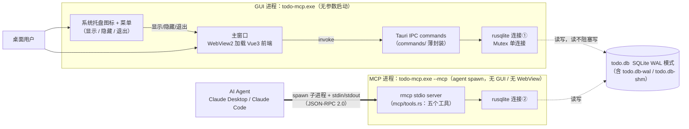

# 桌面端待办任务管理工具 · 技术设计文档

> 文档状态：方案设计中
> 创建日期：2026-11-23
> 上游文档：`requirements.md`（需求共识已达成）
> 本文档为设计产物，不含业务代码；文中代码块仅用于说明接口形态与结构约定。

## 0. 设计前提（已确认决策，不再讨论）

| 决策项 | 结论 |
|--------|------|
| 技术栈 | Tauri 2（Rust 后端 + 系统 WebView2），Windows 优先、架构不锁死跨平台 |
| UI 形态 | 系统托盘常驻 + 主窗口 |
| MVP 功能 | 任务 CRUD + 完成状态 + 优先级 + 到期时间；提醒/子任务/标签/循环任务/云同步均二期不做 |
| 存储 | 本地 SQLite 单文件 |
| MCP | stdio 传输起步（服务本机 agent） |
| 硬性约束 | 低内存优先；所有选型在内存与开发效率冲突时向内存倾斜 |

---

## 1. 总体架构

### 1.1 单一 exe 双模式

同一个可执行文件 `todo-mcp.exe`，按启动参数分发为两种互斥的运行模式：

| 模式 | 启动方式 | 行为 |
|------|----------|------|
| GUI 模式 | 无参数（用户双击/开始菜单） | 初始化 Tauri、WebView2 窗口与系统托盘，常驻运行；关闭窗口=隐藏到托盘 |
| MCP 模式 | `--mcp` 参数（由 Claude Desktop / Claude Code 以 `command` 方式 spawn） | **不初始化 Tauri、不创建窗口、不加载 WebView2**，仅构建 tokio 单线程 runtime + rmcp stdio server，通过 stdin/stdout 以 JSON-RPC 2.0 与宿主 agent 通信；进程生命周期由 agent 管理（agent 退出→stdin EOF→进程自然退出） |

选择单 exe 的理由：

- **agent 配置最简**：Claude Desktop 的 `mcpServers.command` 直接指向已安装的应用路径，无需第二个分发物；应用升级后配置不变。
- **分发与版本一致**：GUI 与 MCP 共享同一套 db/mcp 业务代码，单 exe 保证两模式读写的数据结构、校验规则永远同版本。
- **内存不受影响**：Rust 的未执行代码页不会被提交到工作集。MCP 模式不触达 `gui.rs` 的 Tauri 初始化代码，其实测内存接近纯 CLI 程序（目标 ≤20MB，见 §7）。备选方案"拆成 gui/mcp 两个二进制（cargo feature 分包）"被否：分发、安装器、版本对齐成本翻倍，收益仅是理论上的加载页减少，与本应用量级不符。

### 1.2 并发模型：两进程 + 同一个 SQLite 文件

两个进程各自持有一条独立的 SQLite 连接，直接并发读写同一个 `todo.db` 文件，**不引入任何中介进程或 IPC 转发层**。并发安全方案：

1. **WAL 模式**（`PRAGMA journal_mode=WAL`，写库时执行一次，该属性持久化在 db 文件上）：
   - 读不阻塞写、写不阻塞读：reader 读的是 MVCC 快照，writer 以追加方式写 `-wal` 文件。GUI 渲染列表的同时 agent 在写，互不卡顿。
   - 提交即可见：事务 commit 后，其他连接的**下一次**查询立即读到新数据（每条 SELECT 开启新快照），不需要轮询等待窗口。
2. **busy_timeout**（两进程统一 `PRAGMA busy_timeout=5000`）：WAL 下仅剩"写-写冲突"（同一时刻只允许一个 writer）。冲突方不再立即返回 `SQLITE_BUSY`，而是内部等待重试至多 5 秒。
3. **synchronous=NORMAL**：WAL 下该档位在应用崩溃时不丢数据，仅在"操作系统级断电/崩溃"时可能丢失最近几个已提交事务。对个人待办工具是正确取舍（换取写放大显著降低）；若不可接受可回退默认 FULL，接口不变。

**为什么单机桌面场景这样就够了**：写入方只有两个（用户手动操作 GUI + agent 发指令），写事务毫秒级完成，单人场景写-写冲突概率趋近于零，即使撞上也只是 busy_timeout 内等待几毫秒；数据量个人量级（千条以内），WAL checkpoint 压力可忽略；SQLite 官方支持的多进程同文件模型正是为此类场景设计。备选方案均被否：

| 备选 | 否决理由 |
|------|----------|
| 常驻"DB 服务进程"统一转发读写 | 多一个常驻进程直接违背低内存诉求；任一模式必须依赖服务存活，脆弱且复杂 |
| 内存数据库 + 定期落盘 | 崩溃丢数据，与"待办记录"的可靠性预期不符 |
| 每次操作开短连接 | 重复 open/迁移检查的开销无意义；长连接 + WAL 是标准做法 |

配套约定（写进代码规范）：

- 所有写操作包在短事务里（`Connection::transaction`），事务内不做任何 IO 或用户交互等待。
- db 文件路径不经过 Tauri 的路径 API（MCP 模式没有 Tauri 运行时），统一由 `db::resolve_db_path()` 用 `dirs` crate 解析为 `%APPDATA%\todo-mcp\todo.db`，保证两模式解析结果一致。
- 迁移用内嵌 DDL + `PRAGMA user_version` 门闸（见 §3），不引入迁移框架。

### 1.3 架构图



---

## 2. 技术选型清单

| # | 技术项 | 选型 | 版本基线 | 备选（未选原因） |
|---|--------|------|----------|------------------|
| 1 | 应用框架 | Tauri 2（features: `tray-icon`） | 2.x 稳定线 | Wails（Go 生态 MCP SDK 较新）、Electron（内存超标，需求阶段已排除） |
| 2 | MCP SDK | **rmcp（官方 Rust SDK）** | 3.11.0（2026-11-17 发布，实现 MCP `2026-07-28` 规范并兼容 `2025-11-25`） | 自写 JSON-RPC（协议细节/演进成本不值）；mcp-rust 等非官方 crate（社区维护、跟不上规范） |
| 3 | SQLite 库 | **rusqlite + `bundled`** | 0.43.0 | sqlx、tauri-plugin-sql（对比见 2.2） |
| 4 | 前端框架 | **Vue 3 + Vite** | vue ^3 / vite 当前稳定 / @tauri-apps/* ^2 | Svelte 5、纯 vanilla（对比见 2.3） |
| 5 | JSON 序列化 | serde + serde_json | 1.x | 无实质备选：Tauri IPC 与 rmcp 内部均基于 serde，选它零额外成本 |
| 6 | JSON Schema 生成 | schemars | 随 rmcp `server` feature 引入 | 手写 schema 字符串（工具入参 schema 需与 Rust DTO 双维护，易漂移） |
| 7 | UUID | uuid crate，features: `["v7"]` | 1.x | v4（见 2.4，无序） |
| 8 | 数据目录定位 | dirs crate | 当前稳定 | Tauri path API（MCP 模式无 Tauri 运行时，不可共用） |

### 2.1 rmcp（官方 MCP Rust SDK）用法要点

依赖声明（`client`、HTTP 传输等 feature 一律不开，控制编译产物与内存）：

```toml
rmcp = { version = "3.11", features = ["server", "transport-io"] }
# server      默认链路已含 macros + schemars + transport-async-rw
# transport-io 提供 transport::stdio()（stdin/stdout 传输）
```

stdio server 的关键 trait / 宏要点（接口形态示意，非业务代码）：

- **工具即方法**：`#[tool_router]` 标注 `impl` 块，块内每个 `#[tool(description = "...")]` 方法自动注册为一个 MCP tool；入参用 `Parameters<T>` 解包，`T` derive `serde::Deserialize` + `schemars::JsonSchema`，字段类型与文档注释自动生成 `inputSchema`。
- **两种装配方式**：
  - 纯工具 server 用合并形式 `#[tool_router(server_handler)]`，免写独立 `ServerHandler` impl（本项目 MVP 采用）；
  - 需要自定义 server name/version/instructions 时，另写 `#[tool_handler(name = "todo", version = ...)] impl ServerHandler for TodoTools`。
- **启动三步**：`let service = TodoTools::new(db).serve(rmcp::transport::stdio()).await?;` → `service.waiting().await?;`。注意 `serve()` 会挂起等待对端的 `initialize`——**手动在终端裸跑没有任何输出是正常现象**，调试一律走 MCP Inspector 或真实 agent。
- **运行时**：MCP 模式自建 `#[tokio::main(flavor = "current_thread")]` 单线程 runtime（stdio server 无并行计算，单线程 runtime 更省内存）；rusqlite 同步调用在 handler 内直接执行（微秒级短事务），不引入 spawn_blocking。
- **返回值**：MVP 工具返回结构化数据，序列化为 JSON 后经 `CallToolResult::success(vec![ContentBlock::text(json)])` 返回（新版规范允许 `structuredContent` 为任意 JSON 值，agent 可程序化读取）。
- **错误两分层**：入参 schema 违规（缺必填/类型错）→ 协议层 `rmcp::ErrorData::invalid_params`；业务失败（id 不存在等）→ 返回 `isError: true` 的 `CallToolResult`，message 用人类可读中文（见 §4 统一错误语义）。
- **stdio 纪律**：MCP 模式下 **stdout 是协议通道，严禁任何 `println!`/日志打到 stdout**；日志只允许 stderr 或文件（`log` 门面 + 轻量 stderr sink），此条写入 code review 检查项。

### 2.2 SQLite 库：rusqlite bundled（结论）

| 维度 | rusqlite (bundled) | sqlx | tauri-plugin-sql |
|------|--------------------|------|------------------|
| 集成方式 | Rust 侧同步 API，薄封装 SQLite C 库 | 异步、编译期 SQL 校验 | 把 SQL 字符串暴露给前端 JS 执行 |
| 依赖重量 | `libsqlite3-sys` 单一依赖，bundled 静态编译内置 SQLite | 拉入 tokio 异步栈 + 更大依赖树，编译慢 | 底层即 sqlx，重量同左，外加插件桥接层 |
| 与 MCP 进程复用 | ✅ db 模块是纯 Rust，GUI commands 与 MCP tools 调同一个 `task_repo` | 同左可用，但异步栈对单文件本地库是纯开销 | ❌ 数据访问在 WebView JS 里，MCP 进程（纯 Rust）完全无法复用，被迫维护两套数据访问层 |
| 部署 | bundled 静态链接，无系统 `sqlite3.dll` 版本问题，SQLite 版本随构建固定 | 同左（若用 sqlite 特性） | 同左 |
| 校验 | SQL 为运行时字符串（本项目 SQL 少而固定，配集成测试覆盖） | 编译期检查 SQL（好特性，但代价是 build 依赖 DATABASE_URL/offline 元数据） | 无 |

**结论：rusqlite + `bundled`。** 决定性理由是第三行：MCP 进程与 GUI 必须共享同一份 `task_repo`，排除 plugin-sql；单文件本地库不需要连接池与异步 IO，sqlx 的核心卖点用不上。bundled 保证 exe 自包含、离线可装。WAL/busy_timeout 均为运行时 PRAGMA，无需额外 feature；`hooks`/`wal` 等 rusqlite feature 一律不开。

### 2.3 前端框架：Vue 3 + Vite（结论）

| 方案 | 运行时开销 | 开发效率（列表/筛选/行内编辑场景） | 判断 |
|------|-----------|-----------------------------------|------|
| Vue 3 + Vite | 核心 runtime gzip 约 30-40KB，响应式按需追踪 | 声明式渲染 + `v-model`/`computed` 覆盖勾选、筛选、编辑全部需求；Tauri 官方模板直连 | **选用** |
| Svelte 5 | 编译期消除 runtime，包体最小 | 生态与团队熟练度低于 Vue，且本应用包体差仅几十 KB | 备选（若实测证明前端 JS 成为主要内存项再迁移） |
| 纯 vanilla | 零框架开销 | 状态→DOM 手工同步（列表重排、筛选项、编辑态恢复）开发成本最高、最易出 bug | 排除（省下的 KB 与牺牲的开发效率不成比例） |
| Vue 3（不用 Vite） | 同 Vue 3 | 失去 HMR 与生产构建优化，无意义选项 | 排除 |

**结论：Vue 3 + Vite。** 量级判断写明：本应用前端内存差异在"几百 KB"级，而 WebView2 运行时基线是"数十 MB"级，框架选择对总内存影响有限；低内存优先体现在**不引入大型组件库**（如 Element Plus，动辄数百 KB JS + 全量样式），必要控件（下拉、日期时间输入用 `datetime-local` 原生控件、复选框）手写或用原生元素，并在 §5 坚持无动效原则。

### 2.4 JSON 序列化与 UUID

- **serde / serde_json**：事实标准，Tauri IPC 参数与 rmcp 工具 DTO 共用同一套 derive（`Serialize`/`Deserialize`，前端侧统一 `#[serde(rename_all = "camelCase")]`）；无第二个序列化栈。
- **UUID v7**（`uuid::Uuid::now_v7()`）：
  - v7 前缀为毫秒级时间戳，**字典序 ≈ 创建时间序**：`id` 可直接充当稳定的次级排序键与分页 tiebreak，不需要额外的排序辅助列；
  - 相比 v4 全随机：v4 插入 B-tree 时落点随机，索引碎片更多；v7 顺序插入对页写放大更友好（低内存/低 IO 的小额但免费的收益）；
  - 时间可追溯：从 id 本身即可粗读创建时间，排查问题方便。

---

## 3. SQLite 表结构

### 3.1 tasks 表 DDL 草案

```sql
-- 由 src-tauri/src/db/migrate.rs 内嵌执行：首次打开（PRAGMA user_version = 0）时建表
-- 约定：时间列统一存 UTC epoch 毫秒（INTEGER）；id 存 UUIDv7 文本
CREATE TABLE IF NOT EXISTS tasks (
    id           TEXT    NOT NULL PRIMARY KEY,        -- UUIDv7，字典序≈创建时间序，可作排序 tiebreak
    title        TEXT    NOT NULL,                    -- 任务标题，1~500 字符（应用层校验）
    description  TEXT,                                -- 任务详情，可空；NULL = 无描述
    priority     INTEGER NOT NULL DEFAULT 0
                 CHECK (priority IN (0, 1, 2, 3)),   -- 优先级：0=无 1=低 2=中 3=高
    due_at       INTEGER,                             -- 到期时间（UTC epoch 毫秒）；NULL = 无到期
    status       INTEGER NOT NULL DEFAULT 0
                 CHECK (status IN (0, 1)),            -- 状态：0=进行中 1=已完成
    completed_at INTEGER,                             -- 完成时间（UTC epoch 毫秒）
                 CHECK (status = 1 OR completed_at IS NULL),  -- 行级不变式：未完成不得有完成时间
    created_at   INTEGER NOT NULL,                    -- 创建时间（UTC epoch 毫秒）
    updated_at   INTEGER NOT NULL                     -- 最后更新时间（UTC epoch 毫秒）
);

-- 索引命名规范：idx_ 前缀 = 普通索引；uk_ 前缀 = 唯一索引（保留前缀，本表 MVP 无唯一索引）
CREATE INDEX IF NOT EXISTS idx_tasks_due_at ON tasks (due_at);   -- 到期排序 / 到期范围查询
CREATE INDEX IF NOT EXISTS idx_tasks_status ON tasks (status);   -- 状态筛选（列表默认"进行中在前"）

PRAGMA user_version = 1;   -- 迁移门闸：后续表结构演进按 user_version 递增逐级执行
```

**due_at 存储格式：选 INTEGER 毫秒（UTC epoch），不选 RFC3339 文本。** 理由：

1. **可排序性无歧义**：RFC3339 允许 `+08:00`、`Z` 等不同偏移写法，同一时刻可有多种合法文本，字典序被打乱；INTEGER 天然单调，索引范围扫描直接成立。
2. **一致性**：created_at / updated_at / completed_at 同为毫秒整数，全表时间表示统一，序列化代码只有一条路径。
3. **紧凑**：8 字节定长 vs 20-30 字节文本，千条量级虽小，但索引与比较成本一致更低。
4. SQLite 本无日期类型，INTEGER 毫秒是其推荐的可靠排序表示之一；对外呈现（GUI 显示本地时间、MCP 出参转 RFC3339 UTC 字符串）在应用层完成，存储层不做双重职责。

### 3.2 对"公共十字段"规范的裁剪

单机个人工具，按规范逐项裁剪如下；保留的必要项为 **id 主键 + created_at/updated_at 审计时间**：

| 规范字段 | 处理 | 裁剪/保留理由 |
|----------|------|---------------|
| 主键 id | **保留**（uuid v7 TEXT） | 有序、全局唯一，天然主键 |
| create_time / update_time | **保留** → created_at / updated_at | 列表排序与问题排查的最低审计需求 |
| create_by / update_by | 裁剪 | 单机单用户、无账号体系，操作人恒为本人，恒定值列无信息量 |
| 租户维度（tenant_id 等） | 裁剪 | 个人应用无多租户 |
| 省局/组织机构维度 | 裁剪 | 无任何组织层级概念 |
| version 乐观锁 | 裁剪 | 两个写入方（GUI 与 agent）表达的是同一用户意志，冲突语义取 last-write-wins 即可；进程间写串行化已由 SQLite 文件锁 + busy_timeout 保证，应用层乐观锁是重复建设 |
| del_flag 逻辑删除 | 裁剪 | remove_task 为物理删除，MVP 无回收站/恢复需求；逻辑删除徒增每条查询的过滤条件 |
| remark | 裁剪 | description 已承担备注职责，双字段语义重叠 |

### 3.3 索引设计

- `idx_tasks_due_at (due_at)`：MVP 两个高频模式——列表按到期排序、（二期提醒的）到期范围扫描，都走该索引。
- `idx_tasks_status (status)`：默认视图"进行中在前"、筛选 tab（全部/进行中/已完成）都按 status 过滤。
- **命名规范**：`idx_` 普通索引 / `uk_` 唯一索引，名称内嵌表名（`idx_tasks_*`）。理由：一眼区分索引性质与唯一约束，避免把普通索引误当约束排查；表名前缀避免多表场景下的歧义；本表除主键自动索引外暂无唯一约束，`uk_` 前缀作为规范保留位（若二期引入同步去重键等唯一列时启用）。

---

## 4. MCP 工具清单（MVP 五个，不过度）

统一约定（适用于全部工具）：

- **错误语义两层**：
  - 入参违反 JSON Schema（缺必填 `title`/`id`、类型错误、未知字段）→ JSON-RPC 协议错误 `ErrorData::invalid_params`，agent 需修正参数后重试；
  - 业务失败（id 不存在、库访问失败）→ `CallToolResult { isError: true }`，`content` 为人类可读中文 message（如"未找到任务 {id}"），agent 可据此向用户解释。
- **时间字段**：出参一律 UTC RFC3339 字符串（如 `2026-11-25T01:00:00Z`）；入参 `due_at` 接受任意合法 RFC3339（含本地时区偏移），入库前归一化为 UTC epoch 毫秒。
- **并发可见性**：MCP 侧每次请求即时查询、无缓存；GUI 侧在窗口显示/聚焦/本进程操作后重新查询。WAL 下 MCP 写事务提交后，GUI 下一次查询立即读到新值，**读永不阻塞写**；反之亦然。因此"agent 建任务 → 用户切回 GUI 立即看到"只需 GUI 在窗口聚焦事件上触发一次重查（MVP 策略，不做跨进程推送）。
- limit 等数值边界在应用代码钳制（serde 不执行 JSON Schema 的 `maximum`，schema 中的上限同时用于给 agent 的文档提示）。

### 4.1 create_task

| 项 | 内容 |
|----|------|
| 名称 | `create_task` |
| 描述 | 创建一条待办任务 |
| 入参 | 见下方 schema |
| 出参 | 新建后的完整任务对象（structuredContent，字段见 §4.6） |
| 错误语义 | `title` 缺失/超长/空白 → invalid_params；库写入失败 → isError=true（"创建任务失败"） |

```json
{
  "type": "object",
  "properties": {
    "title":       { "type": "string", "minLength": 1, "maxLength": 500, "description": "任务标题（必填）" },
    "description": { "type": "string", "maxLength": 5000, "description": "任务详情（可选）" },
    "priority":    { "type": "integer", "enum": [0, 1, 2, 3], "default": 0, "description": "优先级：0=无 1=低 2=中 3=高" },
    "due_at":      { "type": "string", "format": "date-time", "description": "到期时间，RFC3339（可选）" }
  },
  "required": ["title"],
  "additionalProperties": false
}
```

### 4.2 list_tasks

| 项 | 内容 |
|----|------|
| 名称 | `list_tasks` |
| 描述 | 查询任务列表，支持按状态/优先级筛选，固定按"未完成在前、到期时间升序（无到期排后）、优先级降序"排序 |
| 入参 | 见下方 schema |
| 出参 | `{ "total": 123, "limit": 50, "offset": 0, "tasks": [ 任务对象... ] }`（total 为当前筛选条件下总数，供 agent 判断是否还有下一页） |
| 错误语义 | 枚举值非法（如 priority=5）→ invalid_params；`limit` > 200 代码层钳制为 200（出参回显实际 limit，不报错） |

```json
{
  "type": "object",
  "properties": {
    "status":   { "type": "integer", "enum": [0, 1], "description": "筛选状态：0=进行中 1=已完成（缺省=不过滤）" },
    "priority": { "type": "integer", "enum": [0, 1, 2, 3], "description": "筛选优先级（缺省=不过滤）" },
    "limit":    { "type": "integer", "minimum": 1, "maximum": 200, "default": 50, "description": "分页大小，上限 200" },
    "offset":   { "type": "integer", "minimum": 0, "default": 0, "description": "分页偏移" }
  },
  "additionalProperties": false
}
```

排序 SQL（固定，无 order 参数——MVP 不给 agent 多余自由度）：`ORDER BY status ASC, (due_at IS NULL) ASC, due_at ASC, priority DESC, id ASC`。

### 4.3 update_task

| 项 | 内容 |
|----|------|
| 名称 | `update_task` |
| 描述 | 部分更新任务：只修改出现的字段，未出现的字段保持原值 |
| 入参 | 见下方 schema |
| 出参 | 更新后的完整任务对象 |
| 错误语义 | id 不存在 → isError=true；`title` 出现但为空串 → invalid_params；description/due_at 显式传 `null` 表示"清空该字段"，字段缺席表示"不动"——两者语义不同，DTO 用 `Option<Option<T>>` 双层 Option 区分"缺席"与"显式置空"（serde 原生支持） |

```json
{
  "type": "object",
  "properties": {
    "id":          { "type": "string", "description": "任务 id（必填）" },
    "title":       { "type": "string", "minLength": 1, "maxLength": 500, "description": "新标题（可选）" },
    "description": { "type": ["string", "null"], "maxLength": 5000, "description": "新详情；传 null 清空（可选）" },
    "priority":    { "type": "integer", "enum": [0, 1, 2, 3], "description": "新优先级（可选）" },
    "due_at":      { "type": ["string", "null"], "format": "date-time", "description": "新到期时间；传 null 清除到期（可选）" }
  },
  "required": ["id"],
  "additionalProperties": false
}
```

### 4.4 complete_task

| 项 | 内容 |
|----|------|
| 名称 | `complete_task` |
| 描述 | 将任务标记为已完成（status=1，记录 completed_at） |
| 入参 | `{ "id": "string" }`（required: ["id"]） |
| 出参 | 更新后的完整任务对象 |
| 错误语义 | id 不存在 → isError=true；**幂等**：对已完成的任务重复调用直接返回当前对象，不报错（agent 重试安全） |

独立于 update_task 的理由：完成/勾选是 agent 场景最高频动作，独立工具使描述语义最直白、入参最简，提高模型调用准确率；update_task 的 schema 中刻意**不含 status 字段**（完成状态只能走 complete_task，撤销完成走 GUI 勾选或二期补充 reopen 工具），避免 agent 绕过幂等语义直接改状态。

### 4.5 remove_task

| 项 | 内容 |
|----|------|
| 名称 | `remove_task` |
| 描述 | 删除任务（物理删除，不可恢复） |
| 入参 | `{ "id": "string" }`（required: ["id"]） |
| 出参 | 被删除任务的完整对象快照（供 agent 向用户汇报删了什么） |
| 错误语义 | id 不存在 → isError=true（**不幂等**：与 update 对齐，明确告知"未找到"，防止 agent 在错误 id 上反复重试） |

### 4.6 任务对象出参结构（各工具共用）

| 字段 | 类型 | 说明 |
|------|------|------|
| id | string | UUIDv7 |
| title | string | 标题 |
| description | string \| null | 详情 |
| priority | integer | 0=无 1=低 2=中 3=高 |
| due_at | string \| null | UTC RFC3339；null=无到期 |
| status | integer | 0=进行中 1=已完成 |
| completed_at | string \| null | UTC RFC3339；未完成为 null |
| created_at / updated_at | string | UTC RFC3339 |

命名对齐说明：五个工具命名为 `create_task / list_tasks / update_task / complete_task / remove_task`，统一 create/get-update/list/remove 语义族；**禁用** `save_*`（save 无法表达创建还是更新的意图）、`delete_*`（与既有 remove 风格冲突）。

---

## 5. GUI 功能清单（MVP）

原则：**低内存优先于视觉**——无过渡动画、无皮肤/主题系统、不引入组件库；列表数据量个人千条以内，不做虚拟滚动；所有界面状态由 Vue 响应式驱动，无全局状态库（Pinia 不引入，单 `useTasks` composable 足够）。

| # | 功能 | 交互设计 | 说明 |
|---|------|----------|------|
| 1 | 任务列表 | 主视图单列表；排序固定：未完成在前 → 有到期按到期升序 → 无到期按优先级降序 → id（≈创建序）兜底；与 MCP `list_tasks` 排序完全一致 | 行内显示：完成勾选框、标题、优先级标记（文字 无/低/中/高）、到期时间（本地格式，逾期标红字——纯 CSS 类切换，非动效） |
| 2 | 快捷新建 | 顶部单行输入框，回车即创建（默认 priority=无、无到期）；Esc 清空 | 不打断手头操作的最小创建路径 |
| 3 | 勾选完成 | 勾选 → status=1 + completed_at；取消勾选 → status=0 + completed_at 置空（可撤销完成） | 与 MCP complete_task 同一 repo 函数，语义一致 |
| 4 | 删除 | 行尾删除按钮，点击后原位二次确认（按钮变形为"确认删除？"），无回收站 | 防误删的最低成本方案 |
| 5 | 优先级与到期时间编辑 | 点击行展开行内编辑：标题文本框、优先级下拉（无/低/中/高）、到期时间 `datetime-local` 原生控件；保存/取消 | 不做弹窗编辑器，行内展开避免额外窗口内存 |
| 6 | 筛选 | 顶部三个 tab：全部 / 进行中 / 已完成 | 切换即查询，无本地缓存副本 |
| 7 | 托盘 | 常驻图标；左键单击切换显示/隐藏主窗口；右键菜单：显示主窗口 / 隐藏主窗口 / 退出 | **关闭窗口按钮 = 隐藏到托盘**（常驻语义）；仅托盘菜单"退出"真正退出进程 |
| 8 | 数据刷新 | 窗口显示/聚焦事件触发一次全量重查（配合 §4 并发可见性策略） | 不引入跨进程推送/监听机制 |
| 9 | 防多开 | 二次启动时聚焦已有窗口并退出新进程（tauri-plugin-single-instance） | 托盘常驻应用的标准防呆；两个"自己"写同一库无意义 |

明确不做（MVP）：动画/过渡、深浅主题切换、批量多选操作、拖拽排序、导入导出、回收站。

---

## 6. 项目目录结构

Tauri 2 标准布局（`src-tauri` + 前端 `src`），后端按"入口分发 / mcp / db / commands"分模块：

```text
todo-mcp/
├── .docs/2026-11-23-desktop-todo-mcp/     # 需求与设计文档（requirements.md / design.md）
├── index.html                             # Vite 入口 HTML
├── package.json / vite.config.ts          # 前端构建（vue 插件 + @tauri-apps/cli）
├── src/                                   # ── 前端（Vue 3 + Vite）──
│   ├── main.ts                            # Vue 应用挂载
│   ├── App.vue                            # 布局骨架：筛选 tab + 快捷新建 + 列表
│   ├── types.ts                           # Task DTO（与后端 serde camelCase 出参对齐）
│   ├── composables/
│   │   └── useTasks.ts                    # 唯一状态源：invoke 封装 + 列表/筛选状态 + 聚焦重查
│   ├── components/
│   │   ├── QuickAdd.vue                   # 快捷新建输入框
│   │   ├── FilterTabs.vue                 # 全部/进行中/已完成
│   │   ├── TaskList.vue                   # 列表（排序展示）
│   │   ├── TaskItem.vue                   # 单行：勾选/删除/行内编辑展开
│   │   └── TaskEditor.vue                 # 行内编辑（标题/优先级/到期时间）
│   └── assets/
│       └── styles.css                     # 唯一样式表，无 CSS 框架
└── src-tauri/
    ├── tauri.conf.json                    # 窗口/托盘/打包配置（identifier 等）
    ├── build.rs
    ├── Cargo.toml                         # tauri(tray-icon) / rmcp / rusqlite(bundled) / uuid(v7) / dirs
    ├── icons/                             # 应用与托盘图标
    └── src/
        ├── main.rs                        # 进程入口：解析 argv，含 --mcp → mcp::run()；否则 gui::run()
        ├── gui.rs                         # GUI 模式装配：Tauri Builder、主窗口、托盘菜单与事件、
        │                                  #   关闭=隐藏策略、注册 commands、single-instance 插件
        ├── mcp/
        │   ├── mod.rs                     # MCP 模式入口：tokio(current_thread) runtime +
        │   │                              #   TodoTools::serve(stdio()) + waiting()；日志仅 stderr
        │   ├── tools.rs                   # TodoTools：#[tool_router(server_handler)] 定义五个工具，
        │   │                              #   每个工具 = 参数校验 + 调 db::task_repo + 组装出参
        │   └── dto.rs                     # 工具入参/出参 DTO（Deserialize + schemars::JsonSchema、
        │                                  #   epoch 毫秒 ↔ RFC3339 转换）
        ├── db/
        │   ├── mod.rs                     # 连接管理：resolve_db_path()（dirs，两模式一致）、
        │   │                              #   open()（PRAGMA: WAL / busy_timeout=5000 / synchronous=NORMAL）
        │   ├── migrate.rs                 # 内嵌 DDL + user_version 门闸迁移
        │   └── task_repo.rs               # tasks 表 CRUD：GUI commands 与 MCP tools 共用的唯一实现
        │                                  #   （create/get/update 部分更新/complete/remove/list 固定排序分页）
        └── commands/
            └── mod.rs                     # Tauri IPC 命令薄封装：State<Mutex<Connection>> → task_repo，
                                           #   出参 serde camelCase；不含业务逻辑
```

模块职责边界：`task_repo` 是数据访问唯一入口（GUI 与 MCP 两条路径汇合点）；`commands/` 与 `mcp/tools.rs` 都只做"协议适配 + 参数校验"，不得出现 SQL；`dto.rs` 与前端 `types.ts` 字段一一对应。

---

## 7. 低内存验证方案

### 7.1 预算目标

| 模式 | 预算 | 口径 | 依据 |
|------|------|------|------|
| GUI 模式 | ≤ 100MB 常驻 | **主进程 + 属于本应用的 WebView2 子进程树的工作集合计**（WebView2 运行时是独立进程组，必须计入） | Tauri 2 典型 30-60MB + WebView2 基线，留余量 |
| MCP 模式 | ≤ 20MB 常驻 | 单进程工作集 | 纯 Rust + 单线程 tokio + rmcp，无 GUI 组件，预期实测 5-15MB |

统计口径统一用 **WorkingSet64（工作集）** 为主、PagedMemorySize64（提交内存）为辅，两者都记录。

### 7.2 观测方法（PowerShell）

```powershell
# 主进程（GUI 与 MCP 通用）
Get-Process todo-mcp | Select-Object Id, ProcessName,
  @{n='WS_MB';e={[math]::Round($_.WorkingSet64/1MB,1)}},
  @{n='PM_MB';e={[math]::Round($_.PagedMemorySize64/1MB,1)}}

# GUI 模式：归属本应用的 WebView2 子进程合计
# （WebView2 子进程命令行含 --webview-exe-name=<宿主exe名>，以此归组）
Get-CimInstance Win32_Process -Filter "Name='msedgewebview2.exe'" |
  Where-Object { $_.CommandLine -match 'webview-exe-name=todo-mcp' } |
  ForEach-Object { Get-Process -Id $_.ProcessId } |
  Measure-Object WorkingSet64 -Sum | ForEach-Object { [math]::Round($_.Sum/1MB,1) }
```

辅助肉眼核对：任务管理器"详细信息"页按名称排序观察 `todo-mcp.exe`；GUI 模式另核对 `msedgewebview2.exe` 条目数与内存量级。

### 7.3 验证步骤

**MCP 模式（release 构建）**

1. `cargo tauri build` 取得 release exe。
2. 空载：由 Claude Desktop 拉起并保持会话，静置 5 分钟，按 §7.2 记录 WS/PM，须 ≤ 20MB。
3. 压测：经 agent 连续执行 50 次 create_task + list_tasks（limit=200）后静置 2 分钟再测，数值应回落/持平（无持续增长 = 无泄漏迹象）。
4. 对照：同一台机器裸跑 `todo-mcp.exe --mcp`（无 client 连接）时进程应自然挂起等待 stdin，任务管理器内存同样 ≤ 20MB。

**GUI 模式（release 构建）**

1. 空载启动（托盘 + 主窗口显示），静置 5 分钟，主进程 + WebView2 树合计 ≤ 100MB。
2. 压测：脚本批量写入 1000 条任务后重启应用，浏览/筛选/切换 tab，合计仍 ≤ 100MB。
3. 最小化/隐藏到托盘 30 分钟后复测（托盘常驻是主要驻留形态，此数值即"常驻成本"）。
4. 稳定性：GUI 与 MCP 两进程同时活动（agent 连发 20 条指令 + GUI 持续操作）30 分钟，两进程内存曲线无单调增长。

### 7.4 Claude Desktop 实际接入联调

1. **先走 MCP Inspector 预检**（不依赖 Claude）：
   `npx @modelcontextprotocol/inspector` 以 CLI/STDIO 方式拉起 `todo-mcp.exe --mcp`，确认 initialize 握手成功、`tools/list` 返回五个工具、`call_tool` 各工具往返正常（含一条故意传错参数验证 invalid_params 语义）。
2. **配置 Claude Desktop**（`%APPDATA%\Claude\claude_desktop_config.json`）：

   ```json
   {
     "mcpServers": {
       "todo": {
         "command": "D:\\apps\\todo-mcp\\todo-mcp.exe",
         "args": ["--mcp"]
       }
     }
   }
   ```

3. 重启 Claude Desktop，确认 MCP 图标出现且列出 5 个工具。
4. 自然语言功能回归：让 agent 分别完成"建一条明天到期的中优先级任务""列出我未完成的任务""把刚才那条改到周五""完成它""删掉它"，每步核对工具被正确调用。
5. **双进程一致性**：agent 建任务后切到 GUI（聚焦触发重查）确认可见；GUI 勾选完成后让 agent list_tasks 确认状态同步；全程观察 §7.3 内存。
6. 记录全部数值与截图到 `.docs/` 验收记录，作为 M5 完成依据。

---

## 8. 里程碑拆分

| 里程碑 | 内容 | 可验证的完成标准 |
|--------|------|------------------|
| **M1 项目骨架 + 双模式启动** | Tauri 2 工程建立；`main.rs` 参数分发；`gui.rs` 窗口+托盘（菜单含显示/隐藏/退出）；`mcp/mod.rs` 以 rmcp 拉起仅含占位工具（ping）的 stdio server；目录结构按 §6 落位 | ① `cargo tauri dev` 启动 GUI：主窗口出现、托盘图标出现、菜单三项生效、点关闭窗口缩回托盘、托盘"退出"结束进程；② release exe 以 `--mcp` 经 MCP Inspector 完成 initialize + `tools/list`（返回 ping）；③ `--mcp` 运行期间 `Get-Process msedgewebview2` 无本应用条目（证明未加载 WebView） |
| **M2 SQLite + 任务 CRUD** | `db/mod.rs`（路径/WAL/busy_timeout）、`migrate.rs`（DDL+user_version）、`task_repo.rs` 全量实现；集成测试覆盖 CRUD、部分更新（双层 Option）、排序分页 | ① 首次运行生成 `%APPDATA%\todo-mcp\todo.db`，`PRAGMA journal_mode` 返回 `wal`、`user_version`=1、表与索引结构符合 §3；② `cargo test` 全绿（含非法参数/不存在 id 用例）；③ 双连接并发写压测（100 事务交错）零 `SQLITE_BUSY` 报错、数据零丢失 |
| **M3 GUI** | §5 功能清单全量实现（列表/快捷新建/勾选/删除/编辑/筛选/托盘/聚焦重查/防多开） | ① 按 §5 清单逐项人工验收通过；② 数据重启持久（关进程再开仍在）；③ 1000 条任务下列表滚动、筛选切换无可感知卡顿；④ 关闭=隐藏、退出=真退出验证 |
| **M4 MCP server + Claude Desktop 联调** | `mcp/tools.rs` 五工具实装（复用 task_repo）；统一错误语义；按 §7.4 完成接入 | ① Inspector 预检全通过（含错误语义用例）；② Claude Desktop 列出 5 工具，§7.4 第 4 步五场景自然语言回归通过；③ 双进程一致性（§7.4 第 5 步）通过 |
| **M5 打包 + 内存验证** | NSIS 安装包 + 便携 zip；release 版按 §7.3 完成两模式内存与稳定性验证；接入配置片段写入 README | ① 安装包在干净 Windows 11 机器安装即用（无 sqlite3.dll 等外部依赖）；② GUI ≤100MB / MCP ≤20MB 实测数值与截图落档 `.docs/`，超预算则回到对应模式做优化后复测；③ Claude Desktop 接入片段经第三方机器复现成功 |

依赖关系：M1 → M2 → {M3, M4 可并行} → M5。M2 的 task_repo 是 GUI 与 MCP 的共同底座，必须先行合入。

---

## 9. 风险与备注

| 风险/事项 | 应对 |
|-----------|------|
| rmcp 大版本迭代快（0.x → 3.x 已两次破坏性迁移） | Cargo.toml 锁定 `3.11` 精确版本；升级前读官方 migration guide；工具层宏用最朴素的 `#[tool_router(server_handler)]` 形式，降低宏面暴露 |
| WebView2 内存基线不可控（浏览器内核底线在数十 MB） | GUI 预算以"含 WebView2 树合计 100MB"为准；优化空间在前端资源（无组件库、无动效）而非内核本身 |
| MCP 模式 stdout 污染协议通道 | §2.1 已列为 code review 检查项；日志仅 stderr |
| 手写迁移（user_version）在表结构演进复杂后不够用 | MVP 单表可承受；若二期加标签/子任务导致迁移树复杂，再引入 refinery 类框架，接口不变 |
| agent 误删（remove_task 物理删除不可恢复） | MVP 接受：出参返回删除快照供 agent 汇报；二期可加软删除开关 |
